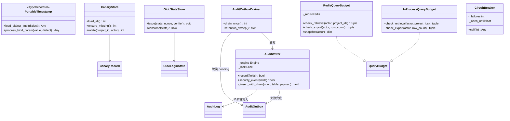
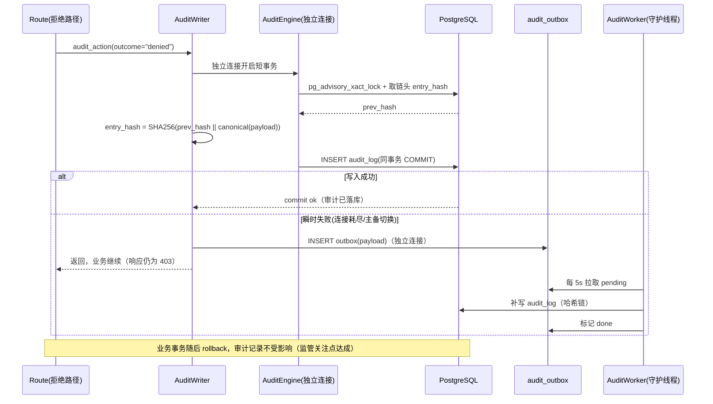
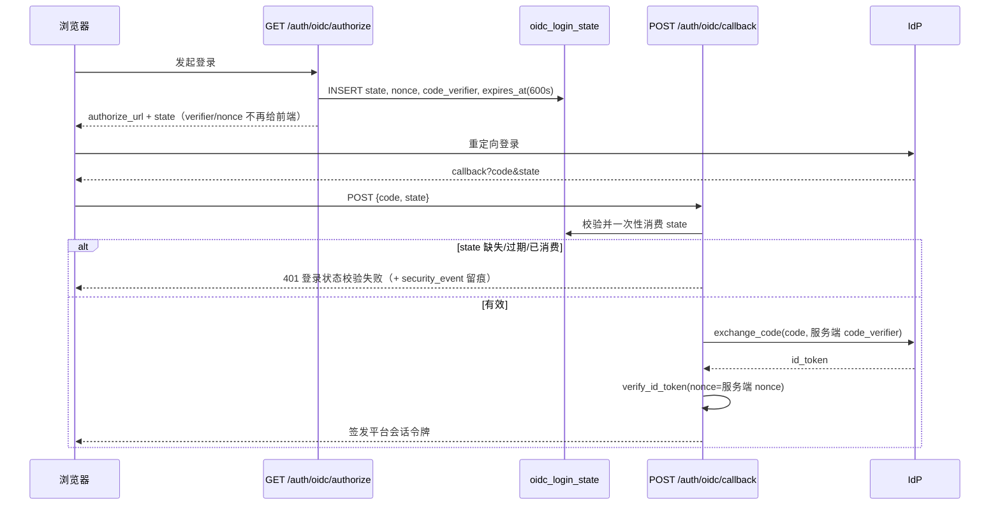

# cloud-rag-governance P0/P1 修复方案设计（diff 级）

> 版本：2026-10-15 ｜ 状态：待评审后开工 ｜ 作者：架构师高见远（software-cloudrag-fixdesign 团队）｜ 汇编：主理人齐活林
>
> 本文所有 `文件:行` 均为逐条读码复核后的现状；伪 diff 只给关键 hunk，非全文。合规口径不虚构条款号，假设全部显式列在 §4.2。

## 1. 修复总顺序与里程碑（10 内容周 + 2 缓冲周，1–2 人兼职）

### 1.1 顺序论证

| 论点 | 依据（代码事实） |
|---|---|
| **PG 路径是上线主干，必须最先打通** | `config.py:227-228` prod validator 明确禁止 SQLite → 私有云 K8s 是唯一可上线形态；P0-1 不修复则 `startup.py:46` 启动即崩，后续任何修复都无法在生产环境验证 |
| **P0-1 的 CI PG 作业是 P0-3 的验证前提** | P0-3 的缺陷只在 PG 显现（SQLite 文本带 `T` 故测试全绿），没有 pgvector service 的 CI 作业就无法防回归 |
| **P0-2 不等 PG，W1 并行交付** | 硬编码密级（`collection.py:280,305`）与数据库方言无关、SQLite 上即可复现即可修、是活跃数据泄露面（QA 实测 L3 岗可读 L4 项目 47 资源 + 32 差异），没有理由排在 PG 后面 |
| **P0-4 独占两周** | 审计解耦 + 哈希链 + outbox + 留存是四个 P0 中工程量和监管权重最大的一项，且与 PG/Jigsaw 无代码耦合，可独立推进 |
| **分支声明（反事实）** | 若改为「SQLite 单机试点」，顺序应为 P0-2 → P0-4 → P0-3 → P0-1（降级为试点后置）。用户已定私有云 K8s，故按 PG 优先论证 |

### 1.2 里程碑总表（每周可独立上线/回滚）

| 周 | 里程碑 | 交付物 | 依赖 | 验收标准 | 回滚点 |
|---|---|---|---|---|---|
| W1 | **M1 环境+止血** | CI 增加 postgres:pgvector service 作业、ruff 门禁去 `|| true`、pytest PG fixture；**P0-2 密级继承修复** + 数据修正脚本 | 无 | QA 测试 1/2/4 全绿；CI 有 PG 作业且通过 | revert PR；修正脚本幂等，反向脚本无需（修正是向 project 真实密级对齐，非降级） |
| W2 | **M2 P0-1 PG 向量路径** ✅ 已完成（2026-10-17，实测记录 §9.5） | `db/vector.py` 重写、`ai/retrieval.py` 授权条件下推 + `ORDER BY <->`、`ensure_pgvector_index` 修正、迁移脚本、PG 测试 | M1（PG fixture） | PG 上 bootstrap 成功；写入/读取往返一致；`EXPLAIN` 走 HNSW；SQLite 全绿不回归 | 环境变量 `RETRIEVAL_BACKEND=memory` 回退旧路径（旧 memory 检索器保留） |
| W3 | **M3 P0-3 拼图时间比较** ✅ 已完成（2026-10-17，实测记录 §9.6） | `jigsaw.py` 时间比较全面改为 datetime 对象（`_as_utc`/`_utc_minus`）、`_maybe_prune` 同步修正、双方言回归测试 8 条 | M1；M2 的 PG 环境 | PG 上窗口过滤/剪枝测试绿（旧实现窗口恒空、误删截止日当天两个症状各一条用例）；SQLite 不回归 | revert（时间比较逻辑独立，风险低） |
| W4 | **M4 P0-4 审计解耦（一期）** | `AuditWriter`（独立引擎/连接/短事务）+ 哈希链 + `audit_outbox` 表 + worker 线程 + 应用账号只插入权限 | 无（与 PG 修复无耦合，SQLite 亦可验） | 拒绝路径审计落库（每条拒绝路径一条测试）；业务事务 rollback 后审计仍在；哈希链校验通过 | 配置 `AUDIT_INDEPENDENT_WRITE=false` 走旧路径（仅紧急止血） |
| W5 | **M5 P0-4（二期）+ 回归** | 留存归档任务（导出→删除，删前必须归档成功）、`verify_audit_chain.py`、审计查询接口兼容、全量回归 | M4 | 改小 `AUDIT_RETENTION_DAYS` 演练归档+删除；chain verify 全绿；性能无劣化 | 同 M4 |
| W6 | **M6 P1 预算 Redis 化** | `RedisQueryBudget`（Lua 原子）、真实 project_id 语义、`check_export` 接入导出路由、`deploy/k8s/07-redis.yaml` + NetworkPolicy 放行 + configmap/secret | 无（可先 `REDIS_ENABLED=false` 上线代码） | QA 测试 3 绿；Redis 故障自动降级进程内并告警；多副本限额语义测试 | `REDIS_ENABLED=false` 一键回退进程内计数器 |
| W7 | **M7 P1 认证与密钥** | `oidc_login_state` 表 + 回调服务端校验一次性消费 + 前端回调改造；`SECRET_KEY/SECURITY_TOKEN_SALT` prod 强校验 + 发布检查单脚本 | 无 | state 重放/伪造/过期各一条拒绝测试；prod 缺密钥或 `CHANGE_ME` 启动失败测试 | 前后端需同步发版（回调只收 `{code,state}`），安排一次性切换窗口 |
| W8 | **M8 P1 canary 持久化** | `canary` 表（密文存储）+ `CanaryStore` 生成/加载/再生成 + startup 加载改造 + 管理端接口 | 无 | 新项目自动补诱饵；重启后 registry 从 DB 加载；再生成留痕；demo 静态 canary 兼容 | DEMO_SEED 静态路径保留作为兜底 |
| W9 | **M9 P1 故障隔离** | `/health` 改 async、外部调用熔断+并发上限、启动回填后台化、超时参数调整 | 无 | 模拟 TEI 挂起：`/health` 200、副本不重启、归因降级 rule 正常；熔断开→半开→恢复测试 | `CIRCUIT_BREAKER_ENABLED=false` / 超时参数回退 |
| W10 | **M10 P2 收尾 + 全量回归 + 文档** | 7 处时间字段统一 decode、`resolve_diff`/`run_attribution` 补 `assert_capability`、vectorizable 与 canary 解耦、CI 全门禁、threat-model T11 状态更新 | M1–M9 | QA 全量四条 + 补充测试集全绿；PG/SQLite 双跑 CI | revert（P2 均为独立小改） |
| W11–12 | **M11 缓冲与试点保驾** | 遗留修复、试点上线支持、验收报告 | — | — | — |

### 1.3 工程任务工作流分组（派发用，5 组，每组 ≥3 文件）

| 工作流 | 周 | 文件 |
|---|---|---|
| **TS1 环境/CI/PG 数据层** | W1–W3 | `.github/workflows/ci.yml`、`apps/api/tests/conftest.py`、`packages/contracts/src/rg_contracts/db/vector.py`、`db/base.py`、`db/models.py`、`ai/retrieval.py`、`security/jigsaw.py`、`apps/api/src/rg_api/startup.py`、`scripts/migrate_pg_vector.py`、`apps/api/tests/test_pg_vector.py`、`test_jigsaw.py`、`deploy/k8s/02-postgres.yaml`（索引参数注释） |
| **TS2 采集密级 + 审计解耦** | W1、W4–W5 | `apps/api/src/rg_api/routes/collection.py`、`scripts/backfill_classification.py`、`packages/contracts/src/rg_contracts/audit/service.py`、`audit/writer.py`(新)、`db/models.py`(audit_outbox+哈希列)、`apps/api/src/rg_api/services/audit.py`、`audit_worker.py`(新)、`main.py`、`routes/{knowledge,attribution,governance,resources,audit,admin}.py`、`scripts/verify_audit_chain.py`、`deploy/k8s/08-audit-verify-cronjob.yaml`(可选) |
| **TS3 预算 + 认证 + 密钥** | W6–W7 | `packages/contracts/src/rg_contracts/security/budget.py`、`config.py`、`db/models.py`(oidc_login_state)、`routes/{knowledge,attribution,governance,auth}.py`、`deploy/k8s/07-redis.yaml`、`06-networkpolicy.yaml`、`01-config.yaml`、`apps/web/src/**`(回调页)、`scripts/check_deploy_secrets.py`、`packages/contracts/pyproject.toml`(redis)、`apps/api/pyproject.toml`(redis) |
| **TS4 金丝雀 + 故障隔离** | W8–W9 | `packages/contracts/src/rg_contracts/security/canary.py`、`canary_store.py`(新)、`security/circuit.py`(新)、`seed/demo.py`、`ai/embedding.py`、`ai/gateway.py`、`routes/{health,knowledge,admin}.py`、`startup.py`、`config.py`、`db/models.py`(canary 表) |
| **TS5 P2 收尾 + 回归** | W10 | `routes/{resources,governance,attribution,collection,knowledge,admin}.py`(时间字段)、`routes/{governance,attribution}.py`(capability)、`ci.yml`、`docs/threat-model.md`、全量 tests |

---

## 2. P0 diff 级设计

### 2.1 P0-1 PostgreSQL 生产路径整体不可用

**现状（已复核）**
- `db/vector.py:21-24`：PG 方言 `load_dialect_impl` 返回 `LargeBinary`（列建成 bytea），但 `:26-32` `process_bind_param` 返回 str 字面量 `"[0.1,0.2,...]"` → 写入即类型错误；`:34-43` `process_result_value` 又按 pgvector 文本解析，自相矛盾。
- `ai/retrieval.py:172-183`：对 bytea 列建 `hnsw … vector_cosine_ops` 必失败；`startup.py:46` bootstrap 调用 → PG 部署启动即崩。
- `ai/retrieval.py:85-123`：读路径从不使用 `<->` 算子，永远 Python 暴力 cosine；候选截断 `max(top_k*20,200)` 且无 ORDER BY（`:89,149`）；`RETRIEVAL_BACKEND`（`config.py:129`）是死配置，无任何分支读取。

> **修复记录（2026-10-17，M2 已完成，见 §9.5）**：本节缺陷分析经真实 PG 16.15 + pgvector 0.8.6 实测证实并落地。与上方伪 diff 的差异：① 维度常量用 `db/vector.py` 的 `EMBEDDING_DIM_HINT`（未走 config 的 `EMBEDDING_DIM`）；② 增加 `session.py::ensure_schema` 内的 `_migrate_legacy_vector_columns()`（幂等，仅当 `udt_name='bytea'` 时 ALTER，不可解析的存量内容显式报错、不静默丢数据）；③ `ensure_pgvector_index` 不再自吞异常，由 startup 捕获后显式 `rollback` 再降级继续 —— 旧代码吞异常留下 aborted 事务，把爆炸转移到 `backfill_embeddings` 的 SELECT 上，是启动被搞死的真凶；④ `SecureRetriever.search` 新增 `_ranked_rows()`，仅对授权候选 ID 集合 `ORDER BY embedding <=> :qv LIMIT n`，铁律「先授权后排序」保持，最终 score 仍由应用层 cosine 精确计算。实测：列 `vector(1024)`、hnsw 余弦索引（5000 行时规划器自然选用）、bootstrap 跑通、1024 维往返误差 5.79e-08、SQLite 66 无回归。

**目标实现（伪 diff）**

```diff
# packages/contracts/src/rg_contracts/db/vector.py  （整文件重写，~50 行）
-from sqlalchemy import JSON, LargeBinary, TypeDecorator
+from sqlalchemy import JSON
+from pgvector.sqlalchemy import Vector as PgVector
+from rg_contracts.config import get_settings
+
+def vector_column():
+    """向量列：PG=pgvector vector(dim)（原生支持 <-> 算子与 HNSW 索引）；SQLite=JSON 数组降级。
+    弃用自研 TypeDecorator：旧实现 PG 分支落 bytea 却绑 str，读写自相矛盾且索引必失败。"""
+    return JSON().with_variant(PgVector(get_settings().EMBEDDING_DIM), "postgresql")
+
+def to_float_list(value) -> list[float]:   # 原 _to_list，保留 numpy/bytes/str 兼容
+    ...
```

```diff
# packages/contracts/src/rg_contracts/db/models.py
-from rg_contracts.db.vector import Vector
+from rg_contracts.db.vector import vector_column
...
-    embedding = mapped_column(Vector, nullable=True)
+    embedding: Mapped[list[float] | None] = mapped_column(vector_column(), nullable=True)
```

```diff
# packages/contracts/src/rg_contracts/ai/retrieval.py
+from sqlalchemy import Float, cast
+from pgvector.sqlalchemy import Vector as PgVector
+from rg_contracts.config import RetrievalBackend
+
+    def _use_pgvector(self) -> bool:
+        """RETRIEVAL_BACKEND 从死配置变为真实分支：AUTO=PG 下推 / PGVECTOR 强制 / MEMORY 强制旧路径。"""
+        b = self.settings.RETRIEVAL_BACKEND
+        if b is RetrievalBackend.PGVECTOR: return True
+        if b is RetrievalBackend.MEMORY: return False
+        return self.session.get_bind().dialect.name == "postgresql"
+
     def search(self, query, subject, allowed_project_ids, allowed_levels, top_k=None, unrestricted=False):
         limit = top_k or self.settings.RAG_TOP_K
         query_vector = self.embedder.embed(query)
-        candidate_ids = self._candidate_ids(..., limit=max(limit * 20, 200))
-        if not candidate_ids: return []
-        rows = session.execute(select(KnowledgeChunk).where(KnowledgeChunk.id.in_(candidate_ids))).scalars().all()
+        if self._use_pgvector():
+            rows = self._search_pg(query_vector, allowed_project_ids, allowed_levels, unrestricted, limit)
+        else:
+            rows = self._search_memory(query_vector, allowed_project_ids, allowed_levels, unrestricted, limit)  # 原逻辑原样保留
         hits = [...原有 RetrievalHit 组装...]
         hits.sort(key=lambda h: h.score, reverse=True)
         return self._apply_diversity(hits, limit)
+
+    def _search_pg(self, query_vector, allowed_project_ids, allowed_levels, unrestricted, limit):
+        """铁律不变：授权条件下推到 SQL WHERE，再在过滤后的集合上做向量排序，绝不做全库召回后过滤。"""
+        stmt = select(KnowledgeChunk)
+        if not unrestricted:
+            if not allowed_project_ids or not allowed_levels: return []
+            stmt = stmt.where(or_(KnowledgeChunk.project_id.in_(allowed_project_ids),
+                                  KnowledgeChunk.project_id.is_(None)))
+            stmt = stmt.where(KnowledgeChunk.classification.in_(allowed_levels))
+        # 用列上 <-> 算子（pgvector 余弦距离）；绑定参数走列类型（PG 上为 vector）的 bind processor
+        distance = KnowledgeChunk.embedding.op("<->", return_type=Float)(query_vector)
+        stmt = stmt.where(distance < 1.0 - self.settings.RAG_MIN_SCORE)
+        return list(self.session.execute(stmt.order_by(distance).limit(limit)).scalars().all())
```

```diff
# packages/contracts/src/rg_contracts/ai/retrieval.py — ensure_pgvector_index（列已是真 vector(1024)，DDL 可成功）
 def ensure_pgvector_index(session, dim=1024):
     bind = session.get_bind()
     if bind is None or bind.dialect.name != "postgresql": return
     session.execute(text(
         "CREATE INDEX IF NOT EXISTS ix_knowledge_chunk_embedding "
-        "ON knowledge_chunk USING hnsw (embedding vector_cosine_ops)"
+        "ON knowledge_chunk USING hnsw (embedding vector_cosine_ops) WITH (m = 16, ef_construction = 64)"
     ))
     session.commit()   # IF NOT EXISTS 幂等，两副本并发启动无竞争问题
```

```diff
# packages/contracts/pyproject.toml（依赖补齐：pgvector 类型现在被 contracts 直接引用，原先只声明在 apps/api）
+    "pgvector>=0.3",
```

**影响面与兼容**
- DDL：新部署 `create_all` 直接建 `vector(1024)`；SQLite 不变（JSON）。
- `upsert_chunk`（retrieval.py:58-61）赋 `list[float]`，两种方言均原生支持，无需改。
- `_apply_diversity`（单项目配额）保留在 Python 侧对 PG top-limit 结果做二次配额，结果数可能 < limit（可接受，文档注明）。
- `RETRIEVAL_BACKEND=memory` 保留完整旧路径，作为回滚开关。
- 安全语义不变且增强：授权过滤与排序在同一条 SQL，`RAG_MIN_SCORE` 也下推。

**数据迁移（`scripts/migrate_pg_vector.py`，一次性，幂等）**
```python
with engine.begin() as conn:
    dt = conn.execute(text(
        "SELECT data_type FROM information_schema.columns "
        "WHERE table_name='knowledge_chunk' AND column_name='embedding'")).scalar()
    if dt == "bytea":   # 旧代码写不进去，列必然为空，直接重建
        conn.execute(text("ALTER TABLE knowledge_chunk DROP COLUMN embedding"))
        conn.execute(text("ALTER TABLE knowledge_chunk ADD COLUMN embedding vector(1024)"))
    # 若历史上以 text/JSON 落过库：ADD COLUMN ... vector(1024) 后用 USING 子句转换（默认不涉及）
```
rollout 顺序：先跑脚本 → 再发新镜像。新环境无此列问题，脚本空转。

**CI（`.github/workflows/ci.yml`）**
```yaml
  backend-pg:                      # 新增作业
    runs-on: ubuntu-latest
    services:
      postgres:
        image: pgvector/pgvector:pg16
        env: { POSTGRES_PASSWORD: postgres, POSTGRES_DB: rgtest }
        ports: ["5432:5432"]
        options: --health-cmd pg_isready --health-interval 10s --health-timeout 5s --health-retries 5
    steps:
      - uses: actions/checkout@v4
      - uses: actions/setup-python@v5
        with: { python-version: "3.12", cache: pip }
      - run: pip install -e packages/contracts && pip install -e "apps/api[dev]"
      - name: Test (PG)
        env: { APP_ENV: test, DB_DIALECT: postgresql, DB_HOST: localhost, DB_PORT: "5432",
               DB_NAME: rgtest, DB_USER: postgres, DB_PASSWORD: postgres, EMBEDDING_BACKEND: offline }
        run: python -m pytest apps/api/tests -q
```
```diff
-      - name: Lint
-        run: ruff check packages apps || true
+      - name: Lint
+        run: ruff check packages apps
```

**验收标准**：QA 四条之外补充——① PG 上 `bootstrap()` 无异常完成（索引建成）；② 写入分片后 `SELECT embedding FROM knowledge_chunk` 可读且维度=1024；③ `EXPLAIN` 检索 SQL 使用 HNSW 索引；④ 授权过滤下推断言（构造越权 project_id，PG/SQLite 均返回空）；⑤ SQLite 既有测试全绿。

---

### 2.2 P0-2 采集器硬编码密级

**现状（已复核）**
- `routes/collection.py:280`（`_upsert_resource` 新建分支）与 `:305`（`_to_diff_model`）写死 `classification="L3_CONFIDENTIAL"`。L4 项目的采集结果被打成 L3，L3 治理岗（`policy.py:155` unrestricted 项目范围 + L3 密级上限）经 `diff_scope_clause`/`_apply_level_filter` 的密级过滤后照读 → QA 实测 47 资源 + 32 差异泄露。

**目标实现（伪 diff）**

```diff
# apps/api/src/rg_api/routes/collection.py
+def _project_classifications(session, project_ids: set[str]) -> dict[str, str]:
+    """项目密级目录：采集数据的数据分级唯一来源（与 Subject.ceiling_for 的 min 语义对齐：
+    数据密级永远不高于项目密级）。"""
+    if not project_ids: return {}
+    rows = session.execute(
+        select(Project.id, Project.classification).where(Project.id.in_(project_ids))
+    ).all()
+    return {pid: lvl for pid, lvl in rows}
+
 # run_collection 内，每个账号 normalized 取到后：
         normalized = provider.fetch_resources()
+        levels = _project_classifications(session, {item.project_id for item in normalized})
+        unknown = {item.project_id for item in normalized} - set(levels)
+        if unknown:
+            # 失败关闭：未知项目不允许默认 L3 重新打开缺口，整账号本次采集失败并留痕
+            snapshot.status = SnapshotStatus.FAILED.value
+            snapshot.error_message = f"project_not_in_directory: {sorted(unknown)[:3]}"
+            audit_action(request, session, subject, "collection:run", "failed", None,
+                         "project_not_in_directory", resource_type="cloud_account", resource_id=account.id)
+            continue
-        for item in normalized:
-            resource = _upsert_resource(session, item)
+        for item in normalized:
+            resource = _upsert_resource(session, item, levels[item.project_id])
...
-                session.add(_to_diff_model(record, snapshot.id))
+                session.add(_to_diff_model(record, snapshot.id, levels[record.project_id]))

 def _upsert_resource(session, item, classification: str) -> Resource:
     existing = ...
     if existing is not None:
         existing.spec = item.spec
         ...
         existing.attributes = item.attributes
+        existing.classification = classification   # 项目密级变更时同步刷新（项目目录为唯一事实源）
         return existing
     resource = Resource(
         ...
-        classification="L3_CONFIDENTIAL",
+        classification=classification,
         ...
     )

 def _to_diff_model(record: DiffRecord, snapshot_id: str, classification: str) -> ResourceDiff:
     return ResourceDiff(
         ...
-        classification="L3_CONFIDENTIAL",
+        classification=classification,
         ...
     )
```

**影响面与兼容**：`Resource.classification` / `ResourceDiff.classification` 列不变；`seed/demo.py:517` 本就按 `resource.classification`（=项目密级）写 diff，不受影响；读取侧（`resources.py`、`governance.py`、`access.py` 行级过滤）无需改动——密级修正后 L3 岗自然被过滤。

**数据修正（`scripts/backfill_classification.py`，rollout 前执行，幂等）**
```sql
-- PostgreSQL
UPDATE resource r SET classification = p.classification FROM project p WHERE r.project_id = p.id;
UPDATE resource_diff d SET classification = p.classification FROM project p WHERE d.project_id = p.id;
-- SQLite 等价子查询写法
```
安全性：把已污染数据对齐到项目真实密级；本身是 L3 的项目行值不变。执行后输出 `SELECT count(*) FROM resource r JOIN project p ON r.project_id=p.id WHERE r.classification <> p.classification` 应为 0。

**验收标准**：直接引用 QA 四条中的 1/2/4——`test_collected_l4_project_resources_hidden_from_governance`（governance 读 prj_data 返回 []）、`test_collected_l4_project_diffs_and_board_hidden_from_governance`、`test_collected_resource_classification_matches_project`（DB 直查 =L4_SECRET）。补充：⑤ 项目密级从 L3 改 L4 后再次采集，既有资源密级刷新；⑥ 未知 project_id 采集失败关闭并留审计。

---

### 2.3 P0-3 拼图防护在 PG 上静默失效

**现状（已复核）**
- `security/jigsaw.py:367-380` `_seen_in_window`：`str(row.ts) >= window_start` 应用层过滤。PG 上 `TS()` 列读出 datetime，`str()` 为空格分隔串，恒小于 ISO `T` 串 → 窗口恒空 → `assess` 的唯一分片数/覆盖率/维度共现全部不触发（拼图防护静默失效）。
- `jigsaw.py:404-424` `_maybe_prune` 同款比较（`str(row[1]) < cutoff`）→ 触发时把该 actor 全部账本误删。
- `jigsaw.py:445-448` `_iso_minus` 返回 ISO 字符串是比较根因；当初为规避「SQL 字符串比较在 PG 绑定失败」选择应用层过滤，衍生此缺陷。
- 附带修复（同根因）：`resources.py:224-226` `ResourceDiff.detected_at >= TimestampCodec.encode(start)` 在 PG 上把 str 绑给 timestamptz 列，时间过滤查询会直接报错（潜在 P0 级，随本次一起消除）。

> **修复记录（2026-10-17，M3 已完成，见 §9.6）**：本节「SQL 层时间绑定 + PortableTimestamp」的设计**未采用**，实际实现更保守：时间过滤仍在应用层（`_seen_in_window` 按 actor 取最近 300 条后 Python 过滤），但比较全面改为 **datetime 对象空间**（新增 `_as_utc()` 规范化 + `_utc_minus()` 产 aware UTC datetime，删除 `_iso_minus`），SQLite 行为逐项不变作回归基准。不条件下推的理由：TS() 列在 SQLite 是 TEXT，向 String 列绑 datetime 依赖已废弃的 sqlite3 适配器且会把存储格式从「T 分隔」变成「空格分隔」，重新引入同类缺陷。**实测推翻本条「潜在 P0」**：`resources.py:224-226` 的 str 绑定在真实 PG 16 上不报错且过滤结果正确（count=1，双方言一致，见 §9.6）—— SQLAlchemy 对比较右侧做了列类型 coercion。该处维持现状，无需修改。

**目标实现（伪 diff）**

```diff
# packages/contracts/src/rg_contracts/db/base.py  （新增，~20 行）
+class PortableTimestamp(TypeDecorator):
+    """时间戳列：SQLite 文本 ISO-8601 / PG timestamptz；绑定 datetime 时按方言自适应，
+    使 `col >= datetime` 在两种方言上都可直接比较（替代应用层字符串比较）。"""
+    impl = String
+    cache_ok = True
+    def load_dialect_impl(self, dialect):
+        return dialect.type_descriptor(DateTime(timezone=True) if dialect.name == "postgresql" else String(32))
+    def process_bind_param(self, value, dialect):
+        if value is None or isinstance(value, str): return value
+        return value if dialect.name == "postgresql" else TimestampCodec.encode(value)
+    def process_result_value(self, value, dialect): return value   # PG datetime / SQLite str，语义同旧 TS()
+
 def TS(index: bool = False):
-    variant = String(32).with_variant(DateTime(timezone=True), "postgresql")
-    return mapped_column(variant, nullable=False, index=index)
+    return mapped_column(PortableTimestamp(), nullable=False, index=index)
 def TS_NULL():
-    variant = String(32).with_variant(DateTime(timezone=True), "postgresql")
-    return mapped_column(variant, nullable=True)
+    return mapped_column(PortableTimestamp(), nullable=True)
```
DDL 不变（SQLite 仍 TEXT、PG 仍 timestamptz），只改绑定路径；SQLite 收到的值仍是 ISO 串，行为逐字节兼容。

```diff
# packages/contracts/src/rg_contracts/security/jigsaw.py
+from datetime import datetime, timedelta
+from rg_contracts.db.base import utcnow
+
     def assess(self, actor_id, project_id, hits, query=""):
         ...
-        window_start = _iso_minus(cfg.SECURITY_JIGSAW_WINDOW_MINUTES)
+        window_start: datetime = utcnow() - timedelta(minutes=cfg.SECURITY_JIGSAW_WINDOW_MINUTES)
...
     def _seen_in_window(self, actor_id, window_start: datetime) -> list[RetrievalLedger]:
-        rows = (self.session.execute(
-            select(RetrievalLedger).where(RetrievalLedger.actor_id == actor_id)
-            .order_by(RetrievalLedger.ts.desc()).limit(300)).scalars().all())
-        return [row for row in rows if str(row.ts) >= window_start]
+        """时间过滤下推 SQL：PortableTimestamp 负责方言自适应绑定。"""
+        return list(self.session.execute(
+            select(RetrievalLedger)
+            .where(RetrievalLedger.actor_id == actor_id, RetrievalLedger.ts >= window_start)
+            .order_by(RetrievalLedger.ts.desc()).limit(300)).scalars().all())
+
     def _maybe_prune(self, actor_id: str) -> None:
         ...
-        cutoff = _iso_minus(self.settings.SECURITY_JIGSAW_RETENTION_DAYS * 24 * 60)
-        rows = self.session.execute(select(RetrievalLedger.id, RetrievalLedger.ts).where(...)).all()
-        stale = [row[0] for row in rows if str(row[1]) < cutoff]
-        if stale: self.session.execute(delete(RetrievalLedger).where(RetrievalLedger.id.in_(stale)))
+        cutoff = utcnow() - timedelta(days=self.settings.SECURITY_JIGSAW_RETENTION_DAYS)
+        self.session.execute(delete(RetrievalLedger).where(
+            RetrievalLedger.actor_id == actor_id, RetrievalLedger.ts < cutoff))
...
-def _iso_minus(minutes: float) -> str:     # 删除
-    ...
```

```diff
# apps/api/src/rg_api/routes/resources.py（同根因的潜在 PG 崩溃，顺带修正）
-    if start: stmt = stmt.where(ResourceDiff.detected_at >= TimestampCodec.encode(start))
-    if end:   stmt = stmt.where(ResourceDiff.detected_at <= TimestampCodec.encode(end))
+    if start: stmt = stmt.where(ResourceDiff.detected_at >= start)
+    if end:   stmt = stmt.where(ResourceDiff.detected_at <= end)
```

**测试（`apps/api/tests/test_jigsaw.py`，PG 参数化，复用 M1 的 fixture）**
```python
@pytest.mark.parametrize("dialect", ["sqlite", "postgresql"])
def test_window_filter_and_prune(dialect, session, ...):
    # 造 3 条账本：2 条窗口内、1 条窗口外
    # assess 后 unique_chunks == 2（旧 PG 实现为 0：窗口恒空）
    # 触发 prune 后窗口外 1 条被删、窗口内 2 条保留（旧 PG 实现误删全部）
```

**验收标准**：QA 四条之外补充——① 上述 PG 参数化用例双方言绿；② PG 上连续检索触发维度共现 → `assess` 返回 elevated 且 action 生效（coarsen/deny 按配置）；③ SQLite 全量不回归；④ `resources.py` 带 start/end 的 diff 列表在 PG 上正常返回。

---

### 2.4 P0-4 拒绝类审计与安全事件在事务回滚时丢失

**现状（已复核）**：`db/session.py:86-96` `session_scope` 异常即 rollback；所有拒绝路径（`knowledge.py:65,69-73,177-178`；`attribution.py:95-99,115-116,167-168`；`governance.py:95-96`；`resources.py:137,162,209`；`audit.py:32,39,64`）都是先 `audit_action/audit_security`（`session.add`）再 raise → DB 中拒绝审计一条不存（stdout 结构化日志仍有留痕，但监管口径下库内审计链断裂）。

**方案选型见 §3（结论：独立连接直写为主 + outbox 兜底 + 日志旁路，叠加追加哈希链）。目标实现（伪 diff）：**

```diff
# packages/contracts/src/rg_contracts/audit/writer.py（新文件，核心 ~120 行）
+class AuditWriter:
+    """审计写入与业务事务彻底解耦：独立引擎、独立连接、独立短事务，提交即落库。
+    业务事务随后 rollback 不影响已提交的审计；写入瞬时失败落 audit_outbox 由后台补写。"""
+    def __init__(self, settings=None):
+        self.settings = settings or get_settings()
+        self._engine = create_engine(self.settings.database_url, pool_size=2, max_overflow=2,
+                                     pool_pre_ping=True, future=True)
+        self._lock = threading.Lock()          # 进程内串行化
+
+    def record(self, *, action, outcome, actor=None, resource_type=None, resource_id=None,
+               project_id=None, reason_code=None, request_id=None, ip=None, user_agent=None,
+               metadata=None) -> bool:
+        payload = {...标准化字段..., "ts": ts()}
+        try:
+            with self._lock, self._engine.connect() as conn:
+                self._insert_with_chain(conn, "audit_log", payload)
+            return True
+        except Exception as exc:
+            logger.error("audit_write_failed", extra={"extra_fields": {"error": str(exc), **payload}})
+            self._to_outbox(payload, "audit")   # 兜底（同样走独立连接）
+            return False
+
+    def security_event(self, *, event_type, detail, actor=None, severity="medium", metadata=None) -> bool:
+        # 同 record，表名 security_event，独立哈希链
+
+    def _insert_with_chain(self, conn, table: str, payload: dict) -> None:
+        with conn.begin():
+            if self._engine.dialect.name == "postgresql":
+                conn.execute(text("SELECT pg_advisory_xact_lock(:k)"), {"k": _LOCK_ID[table]})  # 跨副本串行化
+            prev = conn.execute(text(
+                f"SELECT entry_hash FROM {table} ORDER BY ts DESC, id DESC LIMIT 1")).scalar()
+            entry_hash = _chain_hash(prev, payload)
+            conn.execute(text(f"INSERT INTO {table} (..., prev_hash, entry_hash) VALUES (..., :p, :h)"),
+                         {**payload, "p": prev, "h": entry_hash})
+
+def _chain_hash(prev_hash: str | None, payload: dict) -> str:
+    canonical = json.dumps(payload, sort_keys=True, ensure_ascii=False, separators=(",", ":"))
+    return hashlib.sha256(f"{prev_hash or 'GENESIS'}|{canonical}".encode()).hexdigest()
```

```diff
# apps/api/src/rg_api/services/audit.py（签名不变，30+ 调用点零改动；session 参数保留仅为回滚开关）
 def audit_action(request, session, subject, action, outcome, project_id=None, reason_code=None, ...):
     ip, user_agent = client_meta(request)
-    audit_service(session).record(...)
-    if outcome == "denied": audit_service(session).security_event(...)
+    if get_settings().AUDIT_INDEPENDENT_WRITE:
+        writer = get_audit_writer()          # 进程级单例
+        writer.record(action=action, outcome=outcome, actor=subject, ...)
+        if outcome == "denied":
+            writer.security_event(event_type=f"access_denied:{action}", ...)
+    else:                                     # 回滚开关：旧路径
+        audit_service(session).record(...)
+        if outcome == "denied": audit_service(session).security_event(...)
```

```diff
# packages/contracts/src/rg_contracts/db/models.py
 class AuditLog(Base):
     ...
+    prev_hash: Mapped[str | None] = mapped_column(String(64), nullable=True)
+    entry_hash: Mapped[str | None] = mapped_column(String(64), nullable=True, index=True)
+
+class AuditOutbox(Base):
+    """审计兜底队列：独立写入失败时落库，由 worker 补写。"""
+    __tablename__ = "audit_outbox"
+    id: Mapped[str] = mapped_column(String(64), primary_key=True, default=lambda: new_id("aob"))
+    kind: Mapped[str] = mapped_column(String(16), nullable=False, default="audit")  # audit|security
+    payload: Mapped[dict] = JsonDict()
+    status: Mapped[str] = mapped_column(String(16), nullable=False, default="pending")  # pending|done|failed
+    attempts: Mapped[int] = mapped_column(Integer, nullable=False, default=0)
+    last_error: Mapped[str | None] = mapped_column(Text, nullable=True)
+    created_at: Mapped[str] = TS(index=True)
```

```diff
# apps/api/src/rg_api/audit_worker.py（新文件）+ main.py lifespan 启动守护线程
+def audit_worker_loop():
+    while True:
+        try: drain_once()            # 每 5s：pending → 补写 audit_log/security_event（哈希链）→ 标记 done
+        except Exception: log
+        if 夜间窗口: retention_sweep()   # 归档 → 删除（归档失败绝不删除）
+        time.sleep(5)
```

```diff
# deploy：应用账号收权（PG），防篡改的数据库侧兜底
-GRANT ALL ON audit_log, security_event TO app_user;
+GRANT SELECT, INSERT ON audit_log, security_event TO app_user;   -- 撤销 UPDATE/DELETE
+-- 留存删除由迁移/管理员角色执行
```

**影响面与兼容**：查询路径（`routes/audit.py`、`AuditService.query`）不变；新增列可空；`audit_entry_to_dict` 增加 `entry_hash` 字段（前端忽略即可）；SQLite 开发态同库独立连接（WAL 下短暂锁竞争可接受）。

**验收标准**：QA 四条之外补充——① 每条拒绝路径一条测试：业务 403 后 DB 中 `outcome='denied'` 记录存在（知识注入/越项目/超密级/枚举/预算/审计查询无权限各一）；② 业务事务显式 rollback 后审计记录仍在；③ 独立写入注入故障（mock 断开）→ outbox 有行 → worker 补写后 done；④ `verify_audit_chain.py` 对存量+增量全链校验通过；⑤ 篡改一行历史记录后校验报错定位。

---

## 3. P0-4 审计方案选型

### 3.1 三候选对比

| 维度 | (a) 同库独立连接/独立事务 | (b) outbox 表 + 后台投递 | (c) 日志管道外送 |
|---|---|---|---|
| 可靠性（回滚不丢） | 高（写即提交，与业务事务无共享状态） | 中（依赖同事务 outbox + worker，最终一致） | 低（依赖日志链路，进程崩溃窗口可丢） |
| 防篡改 | 高（可叠加哈希链 + DB 收权只 INSERT） | 中（同上但存在双写窗口） | 中（依赖外部系统 WORM） |
| 留存/归档 | 高（库内 + 归档任务可控） | 中（需额外管理 outbox 生命周期） | 低（留存策略在日志平台侧，跨团队） |
| 复杂度 | 低（一个 Writer + 一个 engine） | 中高（worker、重试、幂等、监控） | 低（代码零改动）但运维依赖外部 |
| 1–2 人兼职可维护性 | 高（纯代码改动，无新组件） | 中低（常驻进程 + 失败队列运营） | 中（需 log 平台配合） |
| 拒绝路径即时可见 | 高（同步可见） | 中（秒级延迟） | 中（依赖采集延迟） |

### 3.2 结论

**(a) 为主通道 + (b) 为兜底队列 + (c) 为旁路，三者叠加，哈希链贯穿。** 理由：监管最痛点是「拒绝留痕 + 不可篡改」，(a) 用最小复杂度解决「回滚不丢」且同步可见；(b) 只作为 (a) 瞬时故障（连接耗尽/PG 主备切换）的保险，不做主路径；(c) 零成本保留现有 stdout 结构化日志并外送日志平台，作为第三方佐证。哈希链 + 应用账号只 INSERT 满足「不可篡改」关注点；归档任务满足「留存」。

### 3.3 表结构与哈希链

- `audit_log` / `security_event` 新增 `prev_hash VARCHAR(64)`、`entry_hash VARCHAR(64)`（索引）。
- 链规则：`entry_hash = SHA256(prev_hash || canonical_json(payload))`，`canonical_json` = `sort_keys=True, ensure_ascii=False, separators=(",",":")`；首条 `prev_hash='GENESIS'`；两表各一条独立链。
- 链头确定：`ORDER BY ts DESC, id DESC LIMIT 1`；PG 用 `pg_advisory_xact_lock(常量)` 跨副本串行化（审计低量，串行开销可忽略）；SQLite 用进程锁。
- payload 覆盖字段：ts、request_id、actor_id、actor_role、action、resource_type、resource_id、project_id、outcome、reason_code、ip、user_agent、metadata_json。
- 校验流程（`scripts/verify_audit_chain.py`，可入 CI 或 k8s CronJob）：
  1. 按 `(ts, id)` 游标分批拉取 `entry_hash / prev_hash / payload`；
  2. 重算 `SHA256(prev_hash || canonical(payload))` 与 `entry_hash` 比对；
  3. 校验 `prev_hash == 上一条 entry_hash`（断链、改单、删行均可定位）；
  4. 输出检查条数/首个断点/结论，退出码非零供告警。
- 留存：`AUDIT_RETENTION_DAYS` 默认 180（假设 A1）；夜间任务先导出 JSONL 到对象存储（`audit-archive/YYYY/MM/DD.jsonl`，MinIO 未就绪则跳过删除并告警）再删除；删除由高权限角色执行。

---

## 4. 监管合规映射表（假设显式化，不引用具体条款号）

### 4.1 修复项 × 监管关注点

| 修复项 | 审计完整性 | 不可篡改 | 访问控制 | 数据分级 | 密钥管理 | 留存 |
|---|---|---|---|---|---|---|
| P0-4 审计解耦+哈希链+只INSERT | ● 拒绝/安全事件全量落库 | ● 哈希链+DB 收权 | ○ | ○ | ○ | ● 归档+保留期 |
| P0-2 密级继承 | ● 采集失败留痕 | ○ | ● L4 数据对 L3 岗不可见 | ● 数据分级=项目分级 | ○ | ○ |
| P0-3 拼图 PG 生效 | ● 风险判定留痕 | ○ | ● 跨查询累积视图在生产生效 | ○ | ○ | ○（账本 7 天） |
| P0-1 PG 路径 | ○ | ○ | ● 授权条件下推在 SQL 内完成 | ○ | ○ | ○ |
| P1 预算 Redis（真实项目 ID） | ● 拦截留痕 | ○ | ● 轮换探测/导出频次 | ○ | ○ | ○ |
| P1 OIDC state 服务端校验 | ● 失败留痕 | ○ | ● 登录 CSRF 防护 | ○ | ○ | ○ |
| P1 密钥 prod 强校验+发布检查 | ○ | ○ | ○ | ○ | ● 禁占位/禁随机 | ○ |
| P1 canary 持久化+密文 | ● 再生成留痕 | ● 密文存储 | ● 原文仅管理员（假设 A6） | ● 泄露检测覆盖生产项目 | ● 独立加密密钥（A6b） | ○ |
| P1 故障隔离 | ○（可用性→业务连续性，间接） | ○ | ○ | ○ | ○ | ○ |

（●=直接满足，○=弱相关/不涉及）

### 4.2 假设清单（需合规/平台负责人确认）

- A1 审计留存 ≥180 天（金融/运营商常见口径假设）。
- A2 审计数据需防篡改校验能力（哈希链 + 只插入权限即视为满足工程口径）。
- A3 拒绝类操作与安全事件必须留痕（含被拦截的越权、枚举、注入、金丝雀命中）。
- A4 密钥由 K8s Secret/ExternalSecret/KMS 托管，严禁明文入库入仓。
- A5 采集数据密级继承项目目录密级，项目目录为唯一事实源。
- A6 诱饵原文仅平台管理员可查看/再生成；金丝雀命中详情限 `security:read` 角色。
- A6b canary 加密密钥生产应显式配置 `CANARY_FERNET_KEY`，未配置时从 SECRET_KEY 派生仅为兼容。
- A7 监管条款编号以合规部门口径为准，本文只做关注点映射。

---

## 5. P1 详细设计

### 5.1 预算 Redis 化（D2）

**合成键双失效根因（已复核）**：`budget.py:62-63` 写 `f"{actor}:{pid}"`（pid 是 `0..project_count-1` 序号非真实项目 ID）→ ① 轮换项目探测漏过（每次 distinct 都是新序号但上限按序号数判定，实际语义错乱）；② 允许项目数 >12 的用户被反向误杀（10 分钟内每次检索全拦，`budget.py:65-67`）。且计数器为进程内 dict（`budget.py:28`），2 副本限额 ×2 可绕、重启重置；`check_export`（`budget.py:81-92`）全仓库零调用点，威胁模型 T11 半落实。

**接口不变 + 键设计**（`security/budget.py` 增加 `RedisQueryBudget`，与修正后的 `InProcessQueryBudget` 实现同一协议；`get_budget()` 按 `REDIS_ENABLED` 选择，Redis 不可达自动降级进程内并告警）：

```python
class QueryBudget(Protocol):
    def check_retrieval(self, actor: str, project_ids: Sequence[str], check_projects: bool = True) -> tuple[bool, str, dict]: ...
    def check_export(self, actor: str, row_count: int) -> tuple[bool, str]: ...
    def snapshot(self, actor: str) -> dict: ...
    def reset(self) -> None: ...

class RedisQueryBudget:
    # Lua：窗口修剪 + 批量 ZADD + ZCARD 一步原子完成
    LUA = """
    local k = KEYS[1]
    redis.call('ZREMRANGEBYSCORE', k, 0, ARGV[1] - ARGV[2])
    for i = 3, #ARGV do redis.call('ZADD', k, ARGV[1], ARGV[i]) end
    redis.call('EXPIRE', k, ARGV[2] * 2)
    return redis.call('ZCARD', k)
    """
    # 键设计（全部带 TTL，无持久化依赖，Redis 丢数据 = 限额重置，可接受降级）：
    #   budget:retrieval:{actor}  ZSET member=请求序号 score=epoch   窗口 3600s → 小时预算
    #   budget:projects:{actor}   ZSET member=真实 project_id        窗口 600s  → 跨项目探测
    #   budget:export:{actor}     ZSET member=请求序号 score=epoch   窗口 3600s → 导出频次(≥10 拦)
    #   budget:blocked:{actor}    STRING INCR + TTL 7200（snapshot 展示）
```

**调用点改造**（`project_count:int` → `project_ids:Sequence[str]`，真实 ID 语义）：
```diff
# routes/knowledge.py:181
-    get_budget().enforce_retrieval(subject.user_id, max(1, len(project_ids)))
+    # unrestricted 角色（admin/governance）免跨项目判定（可信角色），仍受小时预算约束
+    get_budget().enforce_retrieval(subject.user_id, list(project_ids),
+                                   check_projects=not unrestricted)
# routes/attribution.py:103-105
-    project_ids = scoped_project_ids(subject, diff.project_id)
-    get_budget().enforce_retrieval(subject.user_id, max(1, len(project_ids)))
+    get_budget().enforce_retrieval(subject.user_id, [diff.project_id])
```
```diff
# routes/governance.py export_diffs（check_export 接入，兑现威胁模型 T11）
     rows = session.execute(...).scalars().all()
     enforce_export(subject, len(rows))          # 能力 + 单批行数（已有）
+    ok, reason = get_budget().check_export(subject.user_id, len(rows))
+    if not ok:
+        audit_action(request, session, subject, "governance:export", "denied", project_id, reason)
+        raise RateLimitedError("导出频次超出限制") if reason == "export_budget_exceeded" \
+              else PermissionDeniedError("导出批次过大")
```
新增配置：`SECURITY_MAX_DISTINCT_PROJECTS: int = 12`（替掉魔数 12）；进程内实现同步改为真实 ID 语义（保证 `REDIS_ENABLED=false` 时 QA 测试 3 也绿）。

**私有云 Redis 部署清单要点（`deploy/k8s/07-redis.yaml`）**：`redis:7-alpine` 单副本 Deployment（计数器缓存，无持久化要求，emptyDir 即可，禁 AOF 省资源）+ Service 6379 + `redis-secret`（REDIS_PASSWORD，`--requirepass`）；`06-networkpolicy.yaml` 增加 api→redis 6379 入站规则；`01-config.yaml` 增加 `REDIS_ENABLED=true`、`REDIS_URL=redis://redis:6379/0`；secret 增加 `REDIS_PASSWORD`。**注：Redis 只为限额/state 类易失缓存，不存业务数据，单副本故障 = 降级进程内限额，不阻断业务。**

**验收**：QA 测试 3（真实项目 ID 语义）绿；补充：① Redis 停服 → 自动降级+告警，业务不 500；② 双副本下限额合计生效（集成测试用两个 budget 实例共享 Redis）；③ 导出第 11 次被拦且审计落库；④ L3 岗持有 13 个项目权限时正常检索不被误杀（免判定角色语义）。

### 5.2 OIDC state 服务端校验（登录 CSRF）

**现状（已复核）**：`routes/auth.py:190-197` 生成 state 返回前端；`:207-300` 回调无服务端存储无比验（`OidcCallbackRequest` 甚至把 `code_verifier/nonce` 交给前端回传）。

```diff
# packages/contracts/src/rg_contracts/db/models.py（新表）
+class OidcLoginState(Base):
+    __tablename__ = "oidc_login_state"
+    state: Mapped[str] = mapped_column(String(64), primary_key=True)
+    nonce: Mapped[str] = mapped_column(String(64), nullable=False)
+    code_verifier: Mapped[str] = mapped_column(String(128), nullable=False)
+    created_at: Mapped[str] = TS(index=True)
+    expires_at: Mapped[str] = TS(index=True)
+    consumed_at: Mapped[str | None] = TS_NULL()

# routes/auth.py
 @router.get("/oidc/authorize")
 def oidc_authorize(session: Session = Depends(db_session)) -> dict:
     ...
-    return {"authorize_url": url.url, "state": url.state, "code_verifier": url.code_verifier, "nonce": url.nonce}
+    OidcStateStore(session).issue(url.state, url.nonce, url.code_verifier)   # 服务端短时存储，TTL=OIDC_STATE_TTL_SECONDS(600)
+    return {"authorize_url": url.url, "state": url.state}                    # verifier/nonce 不再给前端

 class OidcCallbackRequest(BaseModel):
-    code: str
-    code_verifier: str
-    nonce: str | None = None
+    code: str
     state: str = Field(min_length=8, max_length=64)

 def oidc_callback(payload, session):
     ...
+    stored = OidcStateStore(session).consume(payload.state)   # SELECT+DELETE：不存在/过期/已消费 → None
+    if stored is None:
+        audit_security(session, None, "oidc_state_invalid", "OIDC state 校验失败", severity="high")
+        raise AuthenticationError("登录状态校验失败，请重新发起登录")
-    token_data = client.exchange_code(payload.code, payload.code_verifier)
-    claims = client.verify_id_token(id_token, payload.nonce) if id_token else {}
+    token_data = client.exchange_code(payload.code, stored.code_verifier)
+    claims = client.verify_id_token(id_token, stored.nonce) if id_token else {}
```
前端（`apps/web` 回调页）改为只从 URL 取 `code`+`state` POST 回调；`OidcStateStore.consume` 用 `DELETE ... WHERE state=? AND expires_at>? AND consumed_at IS NULL RETURNING ...`（PG/SQLite 3.35+ 均支持 RETURNING，Python 3.12 内置版本满足）；每次 issue 顺带清理过期行。**验收**：① state 重放第二次被拒；② 伪造 state 被拒且留安全事件；③ 过期 state 被拒；④ 正常登录全链路通过（对接测试 IdP）。

### 5.3 密钥校验（SECRET_KEY / SECURITY_TOKEN_SALT 默认随机）

**现状（已复核）**：`config.py:65` `SECRET_KEY` `default_factory=_default_secret`（随机）、`:143` SALT 随机；prod validator（`:222-235`）只查空串 → 多副本登录态随机失效、重启全失效；SALT 随机导致令牌化跨副本不一致且无反向映射表，历史令牌永久失联；`deploy/k8s/01-config.yaml` 三个 `CHANGE_ME` 占位。

```diff
# config.py _validate_production 内追加
+            if not self.SECRET_KEY or len(self.SECRET_KEY) < 32 or self.SECRET_KEY == "CHANGE_ME":
+                raise ValueError("prod 必须注入 SECRET_KEY（长度>=32，禁止 CHANGE_ME 占位）")
+            if not self.SECURITY_TOKEN_SALT or len(self.SECURITY_TOKEN_SALT) < 16 or self.SECURITY_TOKEN_SALT == "CHANGE_ME":
+                raise ValueError("prod 必须显式配置 SECURITY_TOKEN_SALT（长度>=16，禁止 CHANGE_ME）")
```
配套：`scripts/check_deploy_secrets.py`（CI 步骤：grep `deploy/` 与 `.env*` 中 `CHANGE_ME`，命中即失败）纳入发布检查单；`01-config.yaml` 注释明确 SECRET_KEY/SALT/REDIS_PASSWORD 由 ExternalSecret/KMS 注入。**SALT 轮换影响**：轮换后历史令牌失联（无反向映射），建议接受一次性失效并提前公告（列为未决问题 5）。

### 5.4 canary 持久化（生产数据无诱饵）

**现状（已复核）**：`seed/demo.py:546-559` `build_canaries` 取静态常量 `PROJECTS[].canary`，仅 demo 项目有诱饵；生产 `DEMO_SEED=false` 后 registry 为空，泄露检测形同虚设。

```diff
# db/models.py（新表；value 密文存储，防「知诱饵即可规避」）
+class CanaryRecord(Base):
+    __tablename__ = "canary"
+    __table_args__ = (UniqueConstraint("project_id", "kind", name="uq_canary_project_kind"),)
+    id: Mapped[str] = mapped_column(String(64), primary_key=True, default=lambda: new_id("cny"))
+    project_id: Mapped[str] = mapped_column(ForeignKey("project.id"), nullable=False, index=True)
+    kind: Mapped[str] = mapped_column(String(32), nullable=False)     # project_code/owner/milestone/amount/secret_note
+    value_encrypted: Mapped[str] = mapped_column(Text, nullable=False) # Fernet(CANARY_FERNET_KEY)
+    description: Mapped[str | None] = mapped_column(String(190), nullable=True)
+    created_at: Mapped[str] = TS(index=True)
+    rotated_at: Mapped[str | None] = TS_NULL()
+    created_by: Mapped[str | None] = mapped_column(String(64), nullable=True)
```
- `security/canary_store.py`（新）：`load_all()`（启动加载→`build_registry`，兼容原 `CanarySet`）、`ensure_missing()`（对无诱饵项目按规则生成：project_code=`PRJ-{code}-{HEX6}`、owner/milestone/amount/secret_note 随机生成，全部带 `cnry-` 前缀降低误报）、`rotate(project_id, actor)`（管理端再生成，留痕）。
- `startup.py:32-37` `get_canary_registry` 改为：`CanaryStore.ensure_missing()` → `load_all()` → 空且 `DEMO_SEED` 时回退 `build_canaries()`（兼容）。
- 管理端：`GET /admin/canaries`（仅返回数量与掩码，`admin:config`）、`POST /admin/canaries/rotate`（再生成+审计）。
- **验收**：① 新建项目启动后自动有 5 类诱饵；② 重启后 registry 从 DB 加载（计数一致）；③ 再生成后旧诱饵失效、审计留痕；④ demo 模式静态 canary 兼容不破。

### 5.5 同步阻塞外部调用故障传播

**现状（已复核）**：`routes/health.py:12-14` `def health()` 是同步端点（跑 anyio 线程池，默认 40 线程）；`ai/gateway.py:202` timeout 120s、`routes/knowledge.py:127` 逐分片 `embed()`（每次 30s）；TEI 挂起 → 线程池耗尽 → `/health` 探针无响应 → liveness 杀副本 → 重启循环（`startup.py:50` 启动回填同样同步调 TEI）。

```diff
# routes/health.py
-@router.get("/health")
-def health() -> dict:
+@router.get("/health")
+async def health() -> dict:        # 纯存活探针：事件循环响应，不占线程池、不碰 DB/外部依赖
     return {"status": "ok", "request_id": get_request_id()}
# /ready 保持同步但只查 DB（pool_pre_ping），加 2s 超时包裹
```
```diff
# security/circuit.py（新，~50 行）：失败阈值 5 / 恢复 30s / 半开单探针
+class CircuitBreaker:
+    def call(self, fn, *args, **kwargs):
+        if time.monotonic() < self._open_until:
+            raise ExternalServiceError(f"{self._name} 熔断中，稍后重试")
+        try:
+            result = fn(*args, **kwargs); self._on_success(); return result
+        except Exception:
+            self._on_failure(); raise
```
```diff
# ai/gateway.py complete() / ai/embedding.py _embed_http()
-    with httpx.Client(timeout=gateway.timeout_seconds) as client:
-        resp = client.post(gateway.chat_url, json=body, headers=headers)
+    with _SEMAPHORE:                      # BoundedSemaphore(EXTERNAL_CALL_CONCURRENCY=8)，防线程池耗尽
+        _BREAKER.call(lambda: _post(gateway.chat_url, body, headers, gateway.timeout_seconds))
```
```diff
# routes/knowledge.py（逐分片 → 批量）
-        for ordinal, paragraph in enumerate(_split(sanitized_full)):
-            result = sanitizer.sanitize_text(paragraph, ingest_opts)
-            canary.assert_clean(result.text, "knowledge_ingest")
-            vector = embedder.embed(result.text)          # N 次 HTTP ×30s
-            chunk = KnowledgeChunk(...); session.add(chunk); session.flush()
-            retriever.upsert_chunk(chunk, vector)
+        prepared = []
+        for ordinal, paragraph in enumerate(_split(sanitized_full)):
+            result = sanitizer.sanitize_text(paragraph, ingest_opts)
+            canary.assert_clean(result.text, "knowledge_ingest")   # 净化后断言顺序不变
+            prepared.append((ordinal, result.text))
+        vectors = embedder.embed_many([t for _, t in prepared])    # 一次批量 HTTP
+        for (ordinal, text), vector in zip(prepared, vectors):
+            chunk = KnowledgeChunk(...); session.add(chunk); session.flush()
+            retriever.upsert_chunk(chunk, vector)
```
```diff
# startup.py bootstrap
     with session_scope() as session:
-        ensure_pgvector_index(session, settings.EMBEDDING_DIM)
+        try: ensure_pgvector_index(session, settings.EMBEDDING_DIM)
+        except Exception: logger.error("pgvector_index_failed")   # 索引缺失只降性能，不阻断启动
         if settings.DEMO_SEED: seed_everything(session, settings)
-        embedded = backfill_embeddings(session, settings)
+        embedded = 0
+    threading.Thread(target=_safe_backfill, args=(settings,), daemon=True).start()  # 回填后台化+整体 60s 超时
```
超时调参：`EMBEDDING_TIMEOUT_SECONDS` 30→10、`MODEL_GATEWAY_TIMEOUT_SECONDS` 120→30（prod configmap）；归因失败已有规则降级（`gateway.py:230-235`）保留。**验收**：① 模拟 TEI 挂起（toxiproxy/iptables DROP），`/health` 持续 200、副本不重启；② 熔断器开→半开→恢复三态测试；③ 归因在 TEI 挂起时返回 rule 降级结果（200 而非 500）；④ 启动不再被回填阻塞（readiness 15s 内 ready）。

---

## 6. P2 随 P0 顺带处理（概要）

| 项 | 位置（已复核） | 处理 |
|---|---|---|
| PG 上时间字段返回 `""` | `resources.py:87`、`governance.py:75`、`attribution.py:260,306`、`collection.py:206`、`knowledge.py:309`、`admin.py:253`（`x if isinstance(x,str) else ""`） | 统一改 `TimestampCodec.decode(x).isoformat() if x else None`（`audit/service.py:131,149` 的 `str(entry.ts` 一并改） |
| 缺能力断言 | `governance.py:82-108` resolve_diff、`attribution.py:78-100` run_attribution | 入口补 `assert_capability(subject, "diff:resolve"/"attribution:run")`（viewer 不再能处置差异/烧配额） |
| vectorizable 绑死 canary | `knowledge.py:76-82` | 新增 `RAG_VECTORIZE_ENABLED`（默认 true，prod configmap 显式置 true），与 `SECURITY_CANARY_ENABLED` 解耦 |
| CI | `ci.yml:29` `|| true`、无 PG 作业 | 已含于 M1 |
| 威胁模型状态 | `docs/threat-model.md` T11 | M10 更新为「已落实（check_export + Redis 限额）」 |

---

## 7. 风险与未决问题

| # | 事项 | 影响 | 需谁确认 | 阻塞 |
|---|---|---|---|---|
| 1 | **Redis 排期与归属**：私有云是否已有 Redis 服务；无则新增部署需基础设施审批 | M6 | 基础设施/平台负责人 | W6 |
| 2 | **TEI/模型分发方式**：内网镜像仓库是否已入库 BGE-M3 TEI 镜像与权重 | M9 验证 | 基础设施 | W9 |
| 3 | **诱饵可见性策略**：谁可看诱饵原文、命中详情给哪些角色（现按假设 A6） | M8 | 平台负责人+安全 | W8 |
| 4 | **审计留存期限与归档介质**：≥180 天为假设；MinIO 是否随平台部署 | M5 | 合规部门 | W5 |
| 5 | **SALT 轮换后历史令牌失联**（无反向映射表）：建议接受一次性失效+公告；若要保留需建映射表（超出本次范围） | M7 | 平台负责人 | W7 |
| 6 | **OIDC 回调改造需前后端同步发版**：回调只收 `{code,state}`，verifier/nonce 不再经过前端 | M7 | 前端+发布窗口 | W7 |
| 7 | **PG/pgvector 版本组合**：现用 `pgvector/pgvector:pg16`，需确认 HNSW 内存参数（ef_construction=64）在节点规格内 | M2 | 基础设施 | W2 |
| 8 | **监管条款具体编号**：需合规部门提供口径，本文只做关注点映射 | 全局 | 合规部门 | 验收前 |
| 9 | **审计哈希链跨副本咨询锁**在主备切换下的行为（锁随会话释放，无跨会话死锁风险，已评估） | M4 | 架构复审 | W4 |
| 10 | 若改走 SQLite 单机试点：顺序改为 P0-2→P0-4→P0-3→P0-1 降级（§1.1 反事实分支） | 排期 | 平台负责人 | 立项时 |

---

## 8. 附：类图与时序图（mermaid）







---

---

## 9. M1（W1）交付记录

> 状态：**已完成**（本地全绿，PG 作业待 CI 首跑验证——本机无 Docker/PG）

### 9.1 落地清单

| # | 变更 | 文件 |
|---|---|---|
| 1 | ruff 门禁实集（E/F/I，B008 等遗留风格规则留待专项清理），基线 165 → 0 | `packages/contracts/pyproject.toml`、`apps/api/pyproject.toml` |
| 2 | CI Lint 去 `|| true`（真门禁）；新增 `backend-pg` 作业（pgvector/pgvector:pg16 service） | `.github/workflows/ci.yml` |
| 3 | pytest 双方言夹具：`RG_TEST_DIALECT=postgresql` 切 PG（DEMO_SEED=false） | `apps/api/tests/conftest.py` |
| 4 | 启动期索引 DDL 失败不阻断（W1 CI 前置，M2/M9 完善） | `apps/api/src/rg_api/startup.py` |
| 5 | **P0-2 密级继承**：`_project_classifications()` 唯一来源为项目目录；未知 project_id 失败关闭 + 留审计；`_upsert_resource`/`_to_diff_model` 接收密级参数，既有资源同步刷新 | `apps/api/src/rg_api/routes/collection.py` |
| 6 | 存量数据修正脚本（默认 dry-run，`--apply` 写库，PG/SQLite 双语句） | `scripts/backfill_classification.py` |
| 7 | P0-3 修复前，DB 累积类用例在 PG 上跳过（W3 移除） | `apps/api/tests/test_jigsaw.py` |

### 9.2 验收结果

| 项 | 结果 |
|---|---|
| `pytest apps/api/tests` | **66 passed**（61 原有 + 5 新增），0 failed |
| `ruff check packages apps` | **All checks passed** |
| `scripts/smoke_api.py` | **TOTAL=15 FAILED=0** |
| `scripts/smoke_contracts.py` | PASS |
| 负向对照（改回硬编码 L3） | QA 测试 1/2/4/⑤ 共 4 项 **如期失败** → 测试非空转 |
| backfill 脚本功能验证 | 造 3 条不一致 → dry-run 报 3 → `--apply` 修正 rowcount=3 → 残留 0 → 二次执行 no-op（幂等） |

### 9.3 新增验收测试（`apps/api/tests/test_collection_classification.py`）

| 用例 | 覆盖 | 说明 |
|---|---|---|
| `test_collected_l4_project_resources_hidden_from_governance` | QA-1 | L4 项目资源对 L3 治理岗不可见；L4 管理员可读作为正向对照（证明是密级过滤而非数据缺失） |
| `test_collected_l4_project_diffs_and_board_hidden_from_governance` | QA-2 | L4 差异与治理看板对 L3 治理岗不可见 |
| `test_collected_resource_classification_matches_project` | QA-4 | DB 直查：采集资源/差异密级 == 项目密级 |
| `test_project_level_raise_refreshes_resource_classification` | 补充⑤ | 项目 L3→L4 后再次采集，既有资源密级刷新、治理岗随即不可见 |
| `test_unknown_project_collection_fails_closed_and_audited` | 补充⑥ | 未知 project_id：整账号失败关闭、零落库、留 `project_not_in_directory` 审计 |

自建实体（不依赖演示种子）+ `account_id` 隔离，SQLite/PG 双方言可跑。

### 9.4 遗留与下一步

- ~~PG 作业当前只跑 `test_policy` / `test_security` / `test_collection_classification`~~ → **已解除（2026-10-17）**：本机已装 PG 16.15 + pgvector 0.8.6（`D:\workspace\pgsql\pg16`，无 psql.exe，用 psycopg3 连），全量套件实跑 66 total = 41 passed / 21 errors（PG 模式 `DEMO_SEED=false` 无演示用户，登录夹具 401，预期内）/ 1 skipped / 3 failed（P0-3，W3 修复中）。CI PG 作业可跑全量；**演示种子在 PG 上的移植是 W3 前置**。
- `backend-pg` CI 作业仍未在 CI 环境实跑（本地直跑已验证）；首次 push 后需确认（尤其是 `CREATE EXTENSION vector` 权限与 `ensure_schema` 建表）。
- `ci.yml` 各作业 `working-directory: cloud-rag-governance` 沿用原约定，若仓库根目录即项目根目录需改为 `.`——push 前确认一次。

### 9.5 M2（W2 P0-1）落地记录 — 2026-10-17

**改动（5 文件）**
- `packages/contracts/src/rg_contracts/db/vector.py`：PG 分支 `load_dialect_impl` 返回 `pgvector.sqlalchemy.Vector(EMBEDDING_DIM_HINT)` → 列建成 `vector(1024)`；绑定/结果转换交给 pgvector 类型（list[float] ↔ vector）；SQLite 分支（JSON 数组）逐字未动
- `packages/contracts/src/rg_contracts/ai/retrieval.py`：`ensure_pgvector_index()` 不再自吞异常；`SecureRetriever.search()` 新增 `_ranked_rows()`，授权候选 ID 集合内 `ORDER BY embedding <=> :qv LIMIT n` 走 hnsw，铁律「先授权后排序」保持，score 仍由应用层 cosine 计算
- `packages/contracts/src/rg_contracts/db/session.py`：`ensure_schema()` 在 PG 上调用 `_migrate_legacy_vector_columns()`（幂等；仅 `udt_name='bytea'` 时 `ALTER ... TYPE vector(1024) USING ...`；不可解析存量显式报错）
- `packages/contracts/pyproject.toml`：补 `pgvector>=0.3`
- `apps/api/src/rg_api/startup.py`：索引 DDL 失败的 except 中显式 `session.rollback()` 再继续（消除 aborted 事务连环失败）

**独立复核（team lead，不复用工程师脚本）**
- `.workbuddy/lead_verify_out3.txt`：列类型/维度/hnsw 余弦索引/bootstrap/1024 维往返 5.79e-08/`<->`/`<=>`/search 铁律全 PASS（唯一 FAIL 为 70 行小表规划器选 seqscan —— 正确行为）
- `.workbuddy/hnsw_usage_out.txt`：`enable_seqscan=off` 强制走 hnsw；5004 行时规划器自然选择 hnsw；bulk 行已清理
- SQLite 66 passed 亲跑；`ruff check packages apps` All checks passed 亲跑
- PG 全量（干净库 rgtest2 独立跑）：41 passed / 21 errors / 1 skipped / 3 failed（P0-3）

**遗留**
- `KnowledgeChunk.created_at = TS()` 无默认值（兄弟模型走 `TimestampMixin` 有 `default`）：新增插入点忘传会在双方言 NOT NULL 失败；建议后续统一（删 SQLite 时一并处理）
- PG 模式 21 个 API 测试因 `DEMO_SEED=false` 无法运行：演示种子 PG 移植见 W3 与架构师评估

### 9.6 M3（W3 P0-3）落地记录 — 2026-10-17

**改动（1 个源文件 + 1 个新测试文件）**
- `packages/contracts/src/rg_contracts/security/jigsaw.py`：新增 `_as_utc(value)`（str/datetime/naive/垃圾值 → aware datetime | None，naive 按 UTC 假设）与 `_utc_minus(minutes)`（aware UTC datetime）；删除 `_iso_minus`；`assess` 的 window_start、`_seen_in_window`/`_coverage` 的入参、`_maybe_prune` 的 cutoff 全部改 datetime；过滤条件改 `_as_utc(row.ts) is not None and row_dt >= window_start`（含边界语义与 SQLite 文本时代一致）；`_maybe_prune` 对解析不了 ts 的行不删。**未**条件下推 SQL、**未**引入 PortableTimestamp（理由见 §2.3 修复记录）
- `apps/api/tests/test_jigsaw_time_window.py`（新增，8 条双方言回归）：`_as_utc` 全形态规范化、固化旧字符串比较失败模式（告诫后人）、窗口边界含端点、PG 本地偏移形态计入 UTC 窗口、record→assess 累积计数、0 分钟窗口全排除、prune 保留截止日当天更新行/删除真过期行、不删不可解析行（SQLite only，PG timestamptz 存不进垃圾文本故 skip）

**独立复核（team lead，不复用工程师脚本）**
- `.workbuddy/lead_verify_p0_3_out2.txt`：8/8 PASS —— 含 QA 发现的精确失败模式（+08:00 aware vs UTC ISO 同一瞬间相等）、边界（恰在 window_start 计入 / 早 1μs 不计入）、QA PG-2 场景（窗口内 5 条全部计入）、prune 双向（同日期更新行保留 / 真过期删除）
- PG 全量（干净库 rgtest3）：**0 failed**，21 errors（DEMO_SEED=false 登录夹具，预期）、2 skipped；此前 3 个 P0-3 失败用例全绿
- SQLite 全量：**74 passed**（66 基线 + 8 新回归），无回归；ruff All checks passed

**顺带证伪**：fix-plan §2.3 标注的「潜在 P0」（`resources.py:224-226` str 绑 timestamptz 会报错）实测**不成立** —— 真实 PG 上两种绑定形式均正常且过滤正确（`.workbuddy/diff_time_filter2_out.txt`），该处无需改动

---

**交付说明**：第 1–8 章为只读评审+设计产出；第 9 章为 M1/M2/M3 实际落地记录。QA 四条验收测试映射：测试 1/2/4 → M1（已完成），测试 3 → M6；补充验收项已嵌入各里程碑。所有 `文件:行` 均经读码复核，与评审阶段缺陷清单一致。
